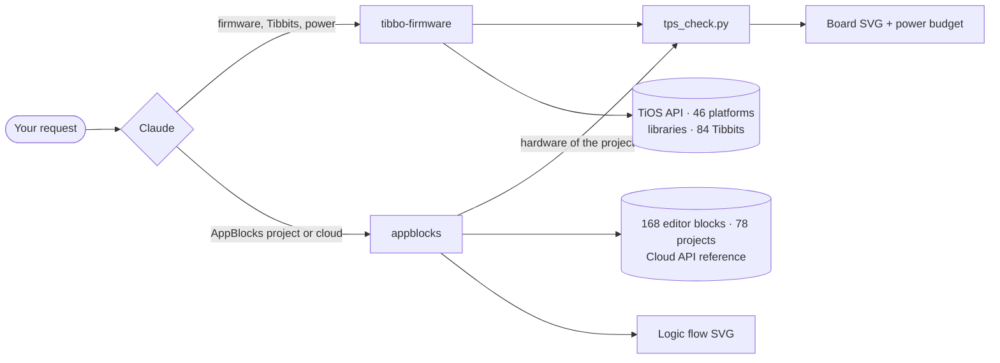

<div align="center">

# Tibbo Skills for Claude

**Agent skills that turn Claude into a Tibbo firmware and AppBlocks engineer.**

Write and review Tibbo BASIC firmware, pick Tibbits and check TPS power budgets,
read, fix and generate AppBlocks projects - with real Tibbo API data instead of guesswork.

[](https://github.com/scancode-iot/tibbo-claude-skills/actions/workflows/tests.yml)
[](LICENSE)
[](#the-skills)
[](#requirements)

**English** · [Русский](README.ru.md)

</div>

---

## Why

Tibbo devices run TiOS - an event-driven OS with its own BASIC dialect, static memory, per-channel cursors
(`sock.num`, `ser.num`), and 60+ libraries that silently do nothing unless every callback and `*_proc_*` hook is wired.
Tibbit selection has its own traps: socket shapes, UART/interrupt lines, 9–18 V inputs on some power Tibbits, ±15 V rails.

General-purpose AI models know little of this and invent API names. These skills give Claude the exact reference data,
working rules and offline checking tools, so its answers can be verified rather than trusted.

> Tested by Tibbo Technology engineers in Taiwan.

## The skills

| Skill | What Claude can do with it |
|---|---|
| [**tibbo-firmware**](skills/tibbo-firmware/) | Write, review and debug Tibbo BASIC / Tibbo C firmware for TiOS (TPP2/TPP3, DS, EM, WM, WS devices); choose Tibbits for a task, lay them out in TPS sockets and check lines, UART/INT, connectors, PoE and the +5 V power budget; draw the board and firmware state machines. |
| [**appblocks**](skills/appblocks/) | Explain, review, edit and generate [AppBlocks](https://appblocks.io) projects (exported JSON); draw the logic flow; check the hardware through `tibbo-firmware`; compile the generated firmware with Tibbo's TIDE compiler; set up MQTT with your own broker; work with the AppBlocks Cloud API (projects, devices, OTA, workflows) with confirmation before any write. |

The two skills are designed to work together: AppBlocks hardware goes through the TPS checker of `tibbo-firmware`,
and firmware that AppBlocks generates for TiOS is reviewed with the `tibbo-firmware` checklist.



## What it looks like

<table>
<tr>
<td width="50%" valign="top">

**TPS board check** - sockets, Tibbits, `PL_IO_NUM_*` lines, `ser.num`, +5 V budget, drawn in the style of the Tibbo configurator.


</td>
<td width="50%" valign="top">

**Errors are numbered on the board** - wrong socket, 24 V into a 9–18 V supply, missing connector.


</td>
</tr>
<tr>
<td colspan="2">

**AppBlocks logic flow** - groups, nodes at their editor positions, coloured by role, port labels on links.


</td>
</tr>
<tr>
<td colspan="2">

**Firmware state machine** - states, outputs, transitions and fault paths taken from the code.


</td>
</tr>
</table>

> Diagram labels are in Russian, as in the original tooling. Claude answers in the language you write in.

## Installation

Download the packages from the [latest release](https://github.com/scancode-iot/tibbo-claude-skills/releases/latest):
`tibbo-firmware.zip` and `appblocks.zip`. Install **both** - `appblocks` uses the checker from `tibbo-firmware`.

### Claude apps (claude.ai, desktop, mobile)

1. Make sure code execution is on: **Settings → Capabilities** (on Team and Enterprise plans an owner enables skills for the organization).
2. Open **Customize → Skills**, click **+** → **Create skill** → **Upload a skill**.
3. Upload `tibbo-firmware.zip`, then repeat for `appblocks.zip`.
4. Check that both are switched on in the skills list.

See [Use skills in Claude](https://support.claude.com/en/articles/12512180-use-skills-in-claude) if the menu looks different.

### Claude Code - as a plugin (recommended)

```text
/plugin marketplace add scancode-iot/tibbo-claude-skills
/plugin install tibbo-skills@scancode
```

Updates arrive with `/plugin marketplace update scancode`.

### Claude Code - manual

```bash
git clone https://github.com/scancode-iot/tibbo-claude-skills.git
mkdir -p ~/.claude/skills
cp -r tibbo-claude-skills/skills/tibbo-firmware tibbo-claude-skills/skills/appblocks ~/.claude/skills/
```

Use `.claude/skills/` inside a project instead of `~/.claude/skills/` to install for one project only.

### Claude Code on Windows

The scripts work with `python` or `python3` from PowerShell, cmd or Git Bash; no extra settings are needed.

- **Console encoding.** Since 1.1.1 the scripts always print UTF-8, so a cp1251/cp1252 console no longer stops them
  with `UnicodeEncodeError`. If Russian text looks garbled in an old `cmd` window, run `chcp 65001` or use Windows Terminal.
- **`CERTIFICATE_VERIFY_FAILED` from `ab_api.py`** while the browser and `curl` open `api.appblocks.io` fine: Python
  is not using the right root certificates. Certificate checks are never switched off; give Python a proper store instead:
  `pip install truststore` (the Windows store, preferred) or `pip install certifi`, or point `SSL_CERT_FILE` to a bundle,
  for example `C:/Program Files/Git/mingw64/etc/ssl/certs/ca-bundle.crt` from Git for Windows.
  `python scripts/ab_api.py tls` shows which store is used and checks the connection.

### Claude API

Upload each skill folder through the [Skills API](https://platform.claude.com/docs/en/build-with-claude/skills-guide)
and pass the returned `skill_id` values in the `container` parameter together with the code execution tool.

## Usage examples

Just describe the task - Claude picks the skill by itself.

```text
I need a TPP3 controller that reads 4 Modbus RTU meters over RS485 and publishes
to MQTT over Wi-Fi. Powered from 24 V in the cabinet, up to 50 °C. Pick the Tibbits
and check the power.
```

```text
Review this Tibbo BASIC project for TPP2W(G3): main.tbs, device.tbs, global.tbh (attached).
Focus on socket handling and DHCP.
```

```text
Here is my AppBlocks export (attached). Explain what the device does,
draw the logic and the board, and list the problems.
```

```text
Add a "pump runtime" variable to this AppBlocks project and reset it every day at midnight.
```

Good habits that make answers better:

- **Name the platform exactly** - `TPP3W(G2)`, `TPP2W(G3)`, `DS1102W`, `EM2000W`.
- **Say which Tibbits sit in which sockets** and **what feeds the power** (12/24/48 V through which Tibbit, PoE).
- For library code, mention `src_lib_ver` from your `.tpr`.

Claude cannot run TIDE: it checks code statically against the reference data and says what was and was not verified.
Always build and test on real hardware.

## Repository layout

```text
tibbo-claude-skills/
├── skills/
│   ├── tibbo-firmware/        # SKILL.md, references/, data/, scripts/, tests/
│   └── appblocks/             # SKILL.md, references/, scripts/, examples/, tests/
├── .claude-plugin/
│   └── marketplace.json       # Claude Code plugin catalog
├── docs/images/               # pictures used in the docs (generated by the skills' own scripts)
├── tools/package.sh           # builds dist/*.zip for upload to Claude
└── .github/workflows/         # tests on every push, release packages on tags
```

## Requirements

The bundled scripts need **Python 3.9+ and nothing else** - only the standard library
(optional: `truststore` or `certifi` for `ab_api.py` on Windows, see above).
They run inside Claude's sandbox automatically; you can also run them yourself:

```bash
cd skills/tibbo-firmware
python3 scripts/tps_check.py find "rs485 modbus"
python3 scripts/tps_check.py check tests/gallery_tpp3.json --svg board.svg
```

The AppBlocks Cloud API client reads the key only from the `APPBLOCKS_API_KEY` environment variable.
In the claude.ai sandbox, add `api.appblocks.io` and `appblocks.io` to the allowed domains first
(**Settings → Capabilities**).

## Tests

```bash
sh skills/tibbo-firmware/tests/run.sh
sh skills/appblocks/tests/run.sh
```

Both suites run offline and on every push (see [Actions](https://github.com/scancode-iot/tibbo-claude-skills/actions)).

## Data sources

The reference files were compiled in October 2026 from:

- [github.com/tibbotech](https://github.com/tibbotech) - TiOS API, platforms, libraries, Tibbit catalog, examples (extracted automatically, names and signatures are exact);
- [docs.tibbo.com](https://docs.tibbo.com) - power supply, sockets and tiles, PoE (written up by hand);
- [appblocks.io](https://appblocks.io) - example projects and the editor's node catalog.

Tibbo releases new libraries and Tibbits from time to time. If something is out of date,
please [open an issue](https://github.com/scancode-iot/tibbo-claude-skills/issues).

## Contributing

Bug reports with a real project or a real editor error are the most valuable contribution.
See [CONTRIBUTING.md](CONTRIBUTING.md).

## License

Code and skill instructions: [MIT](LICENSE) © 2026 Scancode.
Reference data and example projects derived from Tibbo Technology materials remain the property of their owners -
see [NOTICE](NOTICE).

Tibbo, Tibbit, TiOS, TIDE and AppBlocks are trademarks of Tibbo Technology Inc. This project is not an official
Tibbo product. Claude is a product of Anthropic.

<div align="center">

Made by **[Scancode](https://github.com/scancode-iot)** - Tibbo Technology distributor in Russia and the CIS.

</div>
