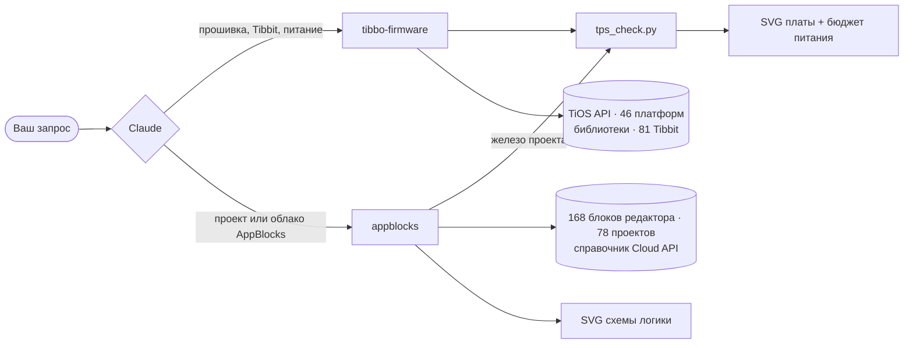
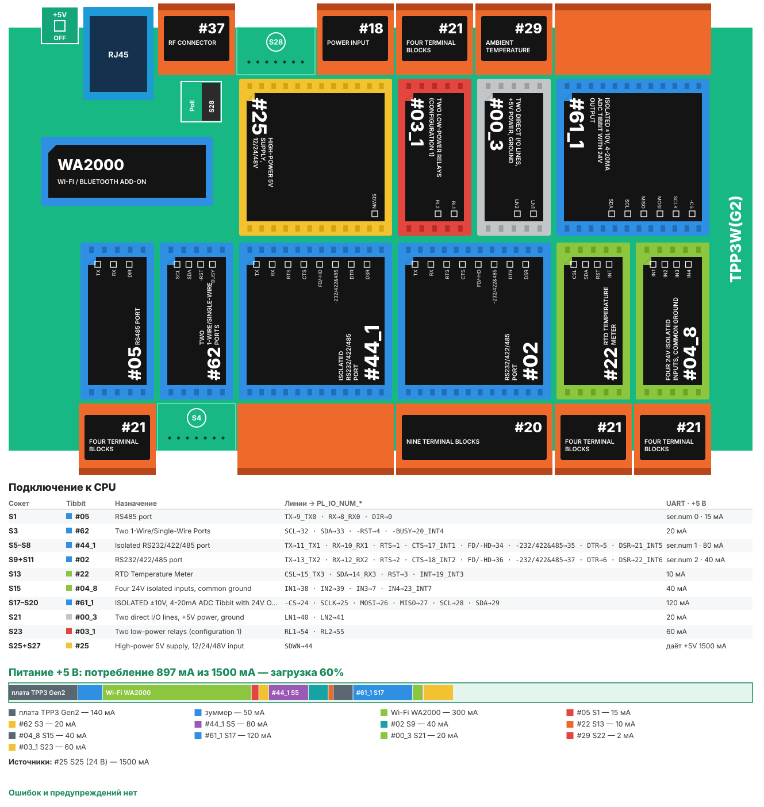
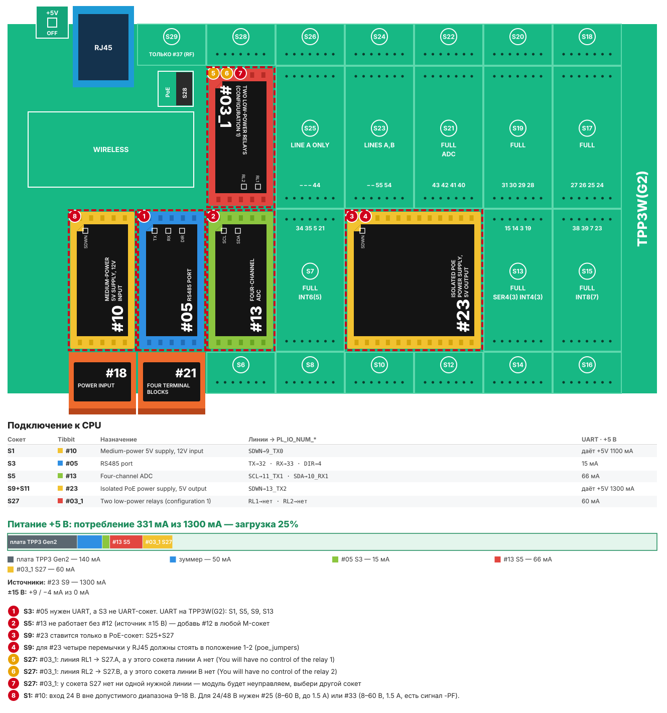
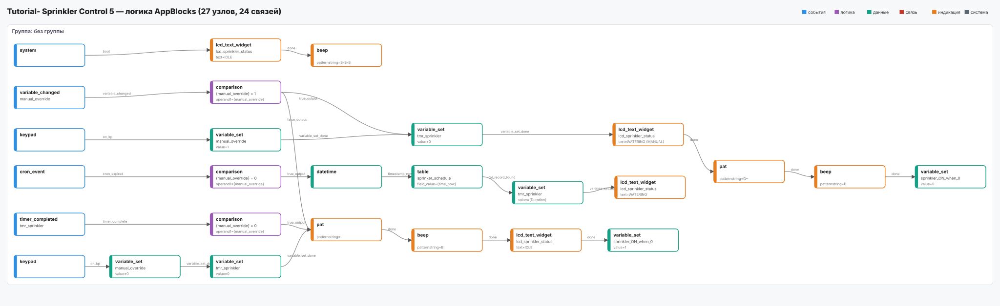
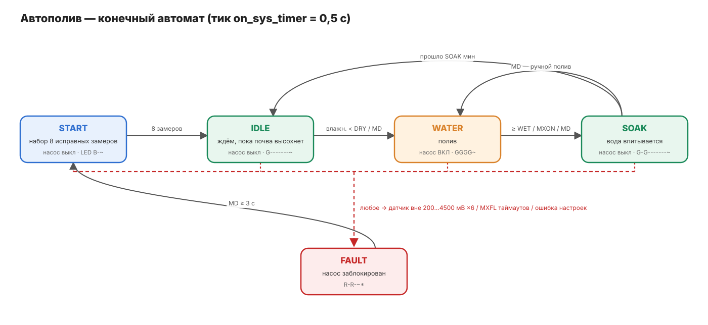

<div align="center">

# Скиллы Tibbo для Claude

**Навыки, которые превращают Claude в инженера по прошивкам Tibbo и проектам AppBlocks.**

Писать и проверять прошивки на Tibbo BASIC, подбирать Tibbit и считать бюджет питания TPS,
разбирать, исправлять и создавать проекты AppBlocks - на точных данных Tibbo API, а не по догадкам.

[](https://github.com/scancode-iot/tibbo-claude-skills/actions/workflows/tests.yml)
[](LICENSE)
[](#скиллы)
[](#требования)

[English](README.md) · **Русский**

</div>

---

## Зачем это нужно

Устройства Tibbo работают на TiOS - событийной ОС со своим диалектом BASIC, статической памятью, «курсорами» каналов
(`sock.num`, `ser.num`) и более чем 60 библиотеками, которые молча не работают, если не реализованы все колбэки
и не проброшены хуки `*_proc_*`. У подбора Tibbit свои ловушки: формы сокетов, линии UART и прерываний,
вход 9–18 В у части источников питания, шина ±15 В.

Универсальные модели знают об этом мало и выдумывают имена API. Скиллы дают Claude точные справочные данные,
правила работы и офлайн-инструменты проверки, поэтому его ответы можно проверить, а не принимать на веру.

> Скиллы протестированы инженерами Tibbo Technology на Тайване.

## Скиллы

| Скилл | Что умеет Claude с ним |
|---|---|
| [**tibbo-firmware**](skills/tibbo-firmware/README.ru.md) | Писать, проверять и отлаживать прошивки на Tibbo BASIC / Tibbo C для TiOS (TPP2/TPP3, DS, EM, WM, WS); подбирать Tibbit под задачу, раскладывать их по сокетам TPS и проверять линии, UART/INT, разъёмы, PoE и бюджет питания +5 В; рисовать плату и диаграммы состояний прошивки. |
| [**appblocks**](skills/appblocks/README.ru.md) | Объяснять, проверять, править и создавать проекты [AppBlocks](https://appblocks.io) (экспорт JSON); рисовать схему логики; проверять железо через `tibbo-firmware`; работать с AppBlocks Cloud API (проекты, устройства, OTA, workflow) с подтверждением перед любой записью. |

Скиллы работают в паре: железо проекта AppBlocks проверяется скриптом TPS из `tibbo-firmware`,
а прошивку, которую AppBlocks генерирует для TiOS, проверяют по чек-листу `tibbo-firmware`.



## Как это выглядит

<table>
<tr>
<td width="50%" valign="top">

**Проверка платы TPS** - сокеты, Tibbit, линии `PL_IO_NUM_*`, `ser.num`, бюджет +5 В в стиле конфигуратора Tibbo.



</td>
<td width="50%" valign="top">

**Ошибки пронумерованы прямо на плате** - неверный сокет, 24 В на источник 9–18 В, нет разъёма.



</td>
</tr>
<tr>
<td colspan="2">

**Схема логики AppBlocks** - группы, узлы на своих местах в редакторе, цвет по роли, подписи портов на связях.



</td>
</tr>
<tr>
<td colspan="2">

**Конечный автомат прошивки** - состояния, выходы, переходы и аварийные пути, взятые из кода.



</td>
</tr>
</table>

## Установка

Скачайте пакеты из [последнего релиза](https://github.com/scancode-iot/tibbo-claude-skills/releases/latest):
`tibbo-firmware.zip` и `appblocks.zip`. Ставьте **оба**: `appblocks` пользуется проверкой из `tibbo-firmware`.

### Приложения Claude (claude.ai, десктоп, мобильное)

1. Проверьте, что включено выполнение кода: **Settings → Capabilities** (в тарифах Team и Enterprise скиллы для организации включает владелец).
2. Откройте **Customize → Skills**, нажмите **+** → **Create skill** → **Upload a skill**.
3. Загрузите `tibbo-firmware.zip`, затем так же `appblocks.zip`.
4. Убедитесь, что оба скилла включены в списке.

Если меню выглядит иначе, см. [Use skills in Claude](https://support.claude.com/en/articles/12512180-use-skills-in-claude).

### Claude Code - как плагин (рекомендуется)

```text
/plugin marketplace add scancode-iot/tibbo-claude-skills
/plugin install tibbo-skills@scancode
```

Обновление: `/plugin marketplace update scancode`.

### Claude Code - вручную

```bash
git clone https://github.com/scancode-iot/tibbo-claude-skills.git
mkdir -p ~/.claude/skills
cp -r tibbo-claude-skills/skills/tibbo-firmware tibbo-claude-skills/skills/appblocks ~/.claude/skills/
```

Чтобы поставить только для одного проекта, используйте папку `.claude/skills/` внутри проекта вместо `~/.claude/skills/`.

### Claude API

Загрузите каждую папку скилла через [Skills API](https://platform.claude.com/docs/en/build-with-claude/skills-guide)
и передайте полученные `skill_id` в параметре `container` вместе с инструментом выполнения кода.

## Примеры запросов

Просто опишите задачу - Claude сам выберет скилл.

```text
Нужен контроллер на TPP3: опрашивает 4 счётчика по Modbus RTU через RS485 и отправляет
данные в MQTT по Wi-Fi. Питание 24 В в шкафу, до 50 °C. Подбери Tibbit и проверь питание.
```

```text
Проверь проект на Tibbo BASIC для TPP2W(G3): main.tbs, device.tbs, global.tbh (во вложении).
Особое внимание - работе с сокетами и DHCP.
```

```text
Вот экспорт проекта AppBlocks (во вложении). Объясни, что делает устройство,
нарисуй логику и плату, перечисли проблемы.
```

```text
Добавь в этот проект AppBlocks переменную «наработка насоса» и обнуляй её каждый день в полночь.
```

Что помогает получить точный ответ:

- **Точное имя платформы** - `TPP3W(G2)`, `TPP2W(G3)`, `DS1102W`, `EM2000W`.
- **Какие Tibbit в каких сокетах** и **от чего питание** (12/24/48 В через какой Tibbit, PoE).
- Для кода с библиотеками - `src_lib_ver` из `.tpr`.

Claude не может запустить TIDE: он проверяет код статически по справочным данным и честно пишет, что проверено,
а что нет. Всегда собирайте и проверяйте прошивку на реальном устройстве.

## Структура репозитория

```text
tibbo-claude-skills/
├── skills/
│   ├── tibbo-firmware/        # SKILL.md, references/, data/, scripts/, tests/
│   └── appblocks/             # SKILL.md, references/, scripts/, examples/, tests/
├── .claude-plugin/
│   └── marketplace.json       # каталог плагинов Claude Code
├── docs/images/               # картинки для документации (нарисованы скриптами самих скиллов)
├── tools/package.sh           # собирает dist/*.zip для загрузки в Claude
└── .github/workflows/         # тесты при каждом коммите, пакеты релиза по тегам
```

## Требования

Скриптам нужен **только Python 3.9+** - используется лишь стандартная библиотека.
В песочнице Claude они запускаются автоматически, но их можно запускать и самостоятельно:

```bash
cd skills/tibbo-firmware
python3 scripts/tps_check.py find "rs485 modbus"
python3 scripts/tps_check.py check tests/gallery_tpp3.json --svg board.svg
```

Клиент AppBlocks Cloud API берёт ключ только из переменной окружения `APPBLOCKS_API_KEY`.
В песочнице claude.ai сначала добавьте `api.appblocks.io` и `appblocks.io` в разрешённые домены
(**Settings → Capabilities**).

## Тесты

```bash
sh skills/tibbo-firmware/tests/run.sh
sh skills/appblocks/tests/run.sh
```

Оба набора работают без сети и запускаются при каждом коммите (см. [Actions](https://github.com/scancode-iot/tibbo-claude-skills/actions)).

## Источники данных

Справочники собраны в октябре 2026 года из:

- [github.com/tibbotech](https://github.com/tibbotech) - API TiOS, платформы, библиотеки, каталог Tibbit, примеры (извлечены автоматически, имена и сигнатуры точные);
- [docs.tibbo.com](https://docs.tibbo.com) - питание, сокеты и тайлы, PoE (выписаны вручную);
- [appblocks.io](https://appblocks.io) - проекты-примеры и каталог узлов редактора.

Tibbo периодически выпускает новые библиотеки и Tibbit. Если что-то устарело,
[создайте issue](https://github.com/scancode-iot/tibbo-claude-skills/issues).

## Участие

Самое ценное - сообщения об ошибках с реальным проектом или реальной ошибкой редактора.
См. [CONTRIBUTING.md](CONTRIBUTING.md).

## Лицензия

Код и инструкции скиллов: [MIT](LICENSE) © 2026 Scancode.
Справочные данные и проекты-примеры, полученные из материалов Tibbo Technology, остаются собственностью
правообладателей - см. [NOTICE](NOTICE).

Tibbo, Tibbit, TiOS, TIDE и AppBlocks - товарные знаки Tibbo Technology Inc. Проект не является официальным
продуктом Tibbo. Claude - продукт компании Anthropic.

<div align="center">

Сделано **[Сканкод (Scancode)](https://github.com/scancode-iot)** - дистрибьютором Tibbo Technology в России и СНГ.

</div>
